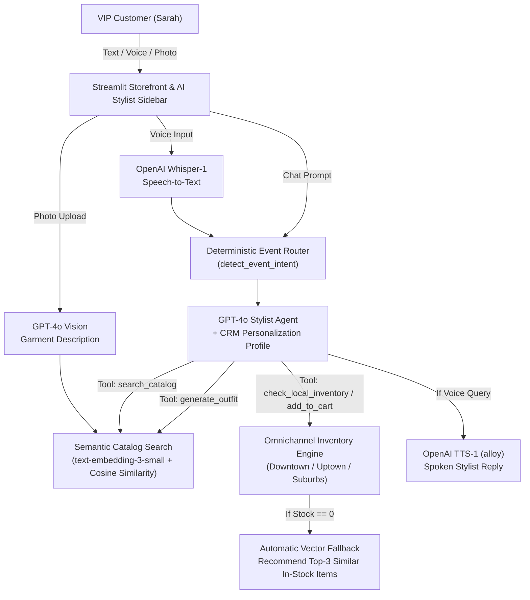

# 🛍️ RetailNext Smart Store — Agentic Omnichannel E-Commerce Prototype


**RetailNext Smart Store** is an omnichannel AI fashion storefront and personal stylist built with **Streamlit** and **OpenAI (`gpt-4o`, `text-embedding-3-small`, `whisper-1`, `tts-1`)**. It combines CRM-personalized semantic product search, **"Snap & Shop"** visual similarity discovery, bidirectional voice commerce, deterministic event routing, and automated out-of-stock fallback recommendations.

---

## 📐 System Architecture



---

## ✨ Enterprise Capabilities

- **CRM-Aware Personalization**: Injects customer tier (`VIP Platinum`), preferred style (`Casual Chic & Elegant`), favorite colors, and fabric exclusions directly into the agent's system context.
- **Deterministic Event Intent Router**: Detects high-value occasions (`wedding`, `office`, `party`, `vacation`, `workout`, `date`, `interview`) in Python and forces the agent to assemble a multi-item outfit with explicit styling rationale.
- **Zero-Stock Save-the-Sale Guardrail**: Hard-checks omnichannel store inventory (`inventory.py`) before adding to cart; if an item is out of stock across all locations (e.g., demo SKU `14325`), blocks the cart addition and uses vector similarity to pitch 3 in-stock alternatives.
- **Multimodal Discovery ("Snap & Shop" + Voice)**: Accepts uploaded clothing photos (via `gpt-4o` Vision) and spoken queries (via `whisper-1` and `tts-1`).

---

## 📁 Project Structure

```text
omnichannel-retail-stylist/
├── main.py                      # Primary application entry point
├── app.py                       # Streamlit entry point alias
├── feature_storefront.py        # Storefront UI, vector search, tool execution, and multimodal stylist loop
├── inventory.py                 # Mock multi-location ERP inventory service with stockout simulation
├── sample_styles.csv            # Fashion product catalog metadata
├── sample_images/               # Product catalog imagery
├── requirements.txt             # Python dependencies
├── .env.example                 # Environment variable template
├── .streamlit/
│   ├── config.toml              # Light luxury storefront theme
│   └── secrets.toml.example     # Streamlit secrets template
└── README.md                    # Project documentation
```

---

## ⚙️ Configuration

| Variable | Required | Description |
| :--- | :---: | :--- |
| `OPENAI_API_KEY` | Yes | OpenAI API key (set in `.env` or `.streamlit/secrets.toml`) |

---

## 🚀 Quickstart

```bash
git clone https://github.com/shubhamv3129/omnichannel-retail-stylist.git
   cd omnichannel-retail-stylist
python3 -m venv .venv
source .venv/bin/activate
pip install -r requirements.txt

cp .env.example .env
# Or: cp .streamlit/secrets.toml.example .streamlit/secrets.toml
# Set your OPENAI_API_KEY

streamlit run main.py
```
